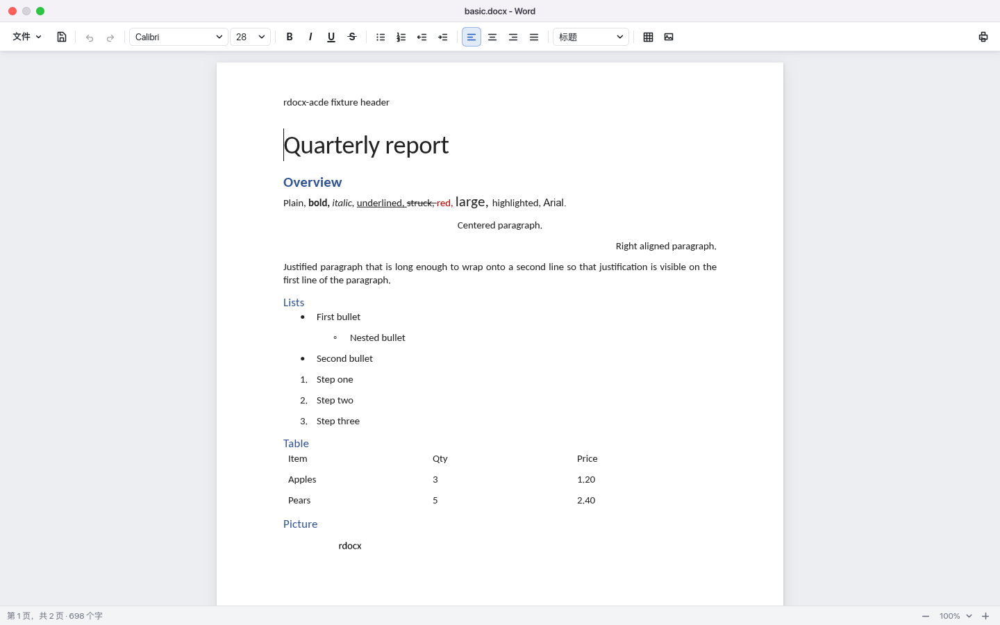
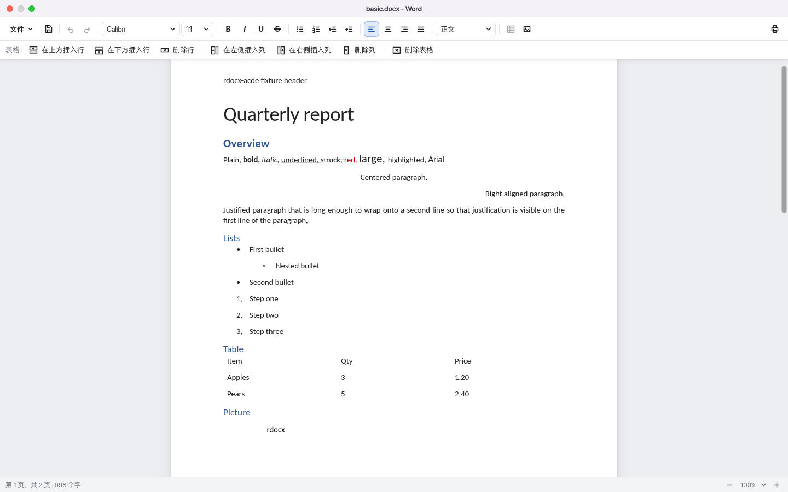
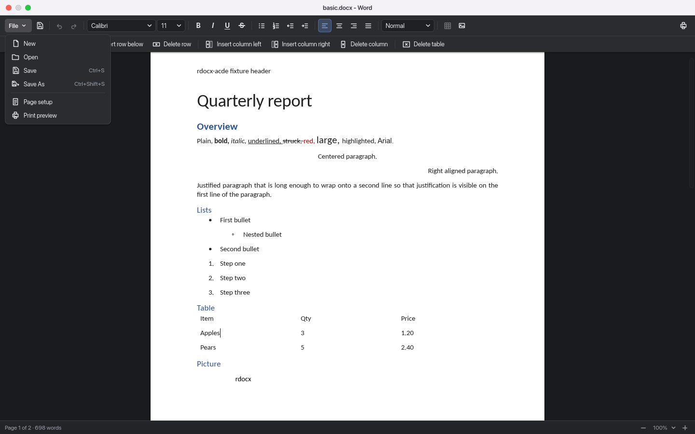

# Folio for Dopame

English | [简体中文](README.zh-CN.md)

A `.docx` editor that runs as a window app on Dopame OS (the acde runtime). It opens a Word document, shows it as
pages, lets you edit it, and saves it back without losing the parts of the file it does not understand. It is built
on the Rust library [rdocx](https://github.com/tensorbee/rdocx), compiled to WebAssembly and loaded in the page.

The interface is in Chinese and English. Chinese documents are the main target: CJK text, SimSun and SimHei,
tables, numbered headings.



| The table bar, shown while the caret is in a table | The File menu, dark theme |
| --- | --- |
|  |  |

## What it does

- **Open and save.** Opens `.docx`, saves and saves as. Bookmarks, comments, fields, content controls and any
  other XML the editor does not model are written back as they were. Every save is checked against the opened file
  before it is written, and a save that would lose something is refused.
- **Text.** Typing, selection, undo and redo, bold, italic, underline, strikethrough, font, size, paragraph style,
  alignment, indent, bulleted and numbered lists.
- **Structure.** Tables (insert, add and remove rows and columns), pictures (PNG and JPEG), page breaks, paper
  size, orientation and margins.
- **Print preview and PDF export.** Laid out by rdocx with the fonts installed on the machine, so Chinese text is
  drawn in the real face.
- **Automation.** `window.word.call(request)` takes one JSON object and answers with one. It reads the document
  (`info`, `outline`, `blocks`, `text`, `find`, `selection`) and edits it through the same commands the keyboard
  uses, so every automated edit is visible and can be undone. The shapes are in
  [`docs/briefs/r6-automation.md`](docs/briefs/r6-automation.md).

Known limits:

- Clipboard and IME composition have not been verified, because a headless session cannot drive them.
- A saved file has not been checked by opening it in Microsoft Word.
- The editing view paginates on its own and can differ from the print preview by a line or two per page. On the
  fixtures, 97 to 100 percent of blocks start on the same page in both.

## How it is built

| Part | Where | What it does |
| --- | --- | --- |
| Model and commands | `src/model.ts`, `src/editor/edit.ts` | The document as plain objects. Every edit is a command, with undo history. |
| Page view | `src/editor/` | Renders blocks as HTML, measures them, paginates, and mounts only the pages near the viewport. Draws its own caret and selection. |
| Engine | `engine/` (Rust), `src/engine/` | rdocx as WebAssembly: import, save with verification, print layout, PDF. |
| Font service | `server.ts`, `server/fonts.ts` | The app's backend. Lists the system's fonts and serves their bytes, since a page cannot read font files. |
| App shell | `src/app.ts`, `src/ui/` | Toolbar, dialogs, status bar, print preview. |
| Automation | `src/automation/` | `window.word`. |

Typing does not go through rdocx. A keystroke changes the model and the page's DOM, and rdocx runs only on open,
on save and for the print preview. The reason, with the measurements behind it, is in
[`docs/design/design.md`](docs/design/design.md). What the runtime can and cannot do is in
[`docs/design/grounding.md`](docs/design/grounding.md).

## Install the prebuilt app

On a machine that already has acde and the Dopame runtime, unpack the package attached to the
[latest release](https://github.com/0x00-Community/folio/releases/latest) into the acde packages directory:

```sh
mkdir -p ~/.local/share/acde/packages
unzip folio-v0.1.0-package.zip -d ~/.local/share/acde/packages
```

The package holds the interface, the backend and the engine, and is the same for every CPU architecture. There is
no `.dmg` or other standalone installer: acde has no standalone packaging yet, and the runtime may not be
redistributed.

## Setup

For working on the code.


You need Node 24 or newer (the tests run TypeScript directly through Node's type stripping) and the `acde` CLI,
for `npm run dev`, `npm run build` and the end-to-end checks.

The engine is not tracked in the repository. Get it one of two ways.

**Download the prebuilt engine.** No Rust needed:

```sh
npm ci
npm run engine:fetch   # downloads public/engine.wasm and src/engine/pkg/ from the release
npm run dev            # starts the app in an acde dev session
```

**Build it from source.** You need `rustup` and the `wasm-bindgen` CLI at exactly 0.2.128
(`cargo install wasm-bindgen-cli --version 0.2.128`). `engine/rust-toolchain.toml` pins Rust 1.97.1 with the
`wasm32-unknown-unknown` target, and rustup installs it on the first build.

```sh
npm ci
npm run engine         # builds engine/ to public/engine.wasm and src/engine/pkg/
npm run dev
```

The engine depends on rdocx changes that are not upstream yet. They are public on the `folio` branch of
[0x00-Community/rdocx](https://github.com/0x00-Community/rdocx), and `engine/Cargo.toml` pins the exact commit,
so cargo fetches it on its own. To work on rdocx and the engine together, point cargo at a local checkout with a
`[patch]` section in `engine/.cargo/config.toml`.

Run `npm run engine` again after any change under `engine/`. The prebuilt engine matches the release it came
from. After pulling changes to `engine/`, fetch again or build.

A release build leaves out the function names, which saves 4 MB. To profile the engine with Rust function names,
build with `WORD_ENGINE_NAMES=1 npm run engine`.

## Checks

| Command | What it runs |
| --- | --- |
| `npm run typecheck` | `tsc --noEmit` |
| `npm test` | Unit tests with `node --test`. Several load `public/engine.wasm`, so build the engine first. |
| `npm run e2e` | Every script in `scripts/e2e/` in one headless `acde dev` session. Takes script names and `--repeat N`. |
| `cargo test` in `engine/` | The engine's native tests: import, save, ledger, print. |
| `npm run check` | `acde check`, which validates the app manifest only. |

Notes on the end-to-end checks:

- `acde dev` reloads the page whenever a file in the project changes. Do not write into the project while they run.
- Screenshots go to a temporary folder. Set `WORD_E2E_EVIDENCE=1` to copy them into `docs/design/evidence/` at the
  end of a run.

Optional environment variables:

| Variable | Use |
| --- | --- |
| `WORD_TEST_DOC`, `WORD_TEST_REF_PDF` | A document of your own, and the PDF Word made from it, for the print checks and benchmarks. Nothing reads them unless they are set. |
| `WORD_TEST_FONTS` | The folder the font tests read. The default is `../rdocx-editing-kit/crates/oxml-layout/fonts`, an rdocx checkout beside this repository. Without either, those tests are skipped. |

Measuring tools:

- `scripts/open-save-bench.mjs`: open and save times of the release wasm in Node.
- `scripts/history-heap.mjs`: heap kept per undo entry. Run it with `node --expose-gc`.
- `scripts/print-bench.mjs`: print layout time and memory.
- `scripts/drift-probe.mjs`: how far the editing view's page breaks are from the print layout's.

## Layout

```
index.html            the page and its styles
server.ts, server/    the backend: font service
src/                  the app (TypeScript, no framework)
engine/               the Rust engine crate
fixtures/             the .docx files the tests use
scripts/              the engine build, e2e checks, benchmarks
docs/design/          the chosen design, what was measured, screenshots
docs/briefs/          one brief per build round, with its status
tools/corpus/         a native tool that writes the fixture documents
```

## Conventions

- TypeScript uses erasable syntax only (no `enum`, no `namespace`, no parameter properties), and relative imports
  carry the `.ts` extension.
- User-facing text lives in `src/locales/zh.ts` and `src/locales/en.ts`.
- The window has no Web Workers and a 512 MB heap. Anything slow freezes the page, so no layout runs at idle.
