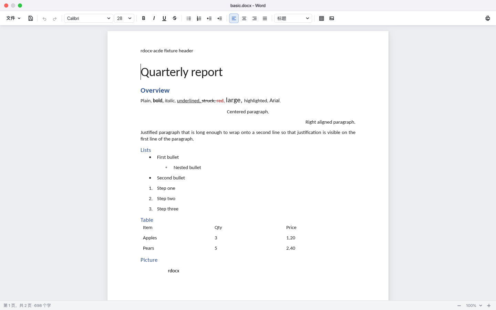
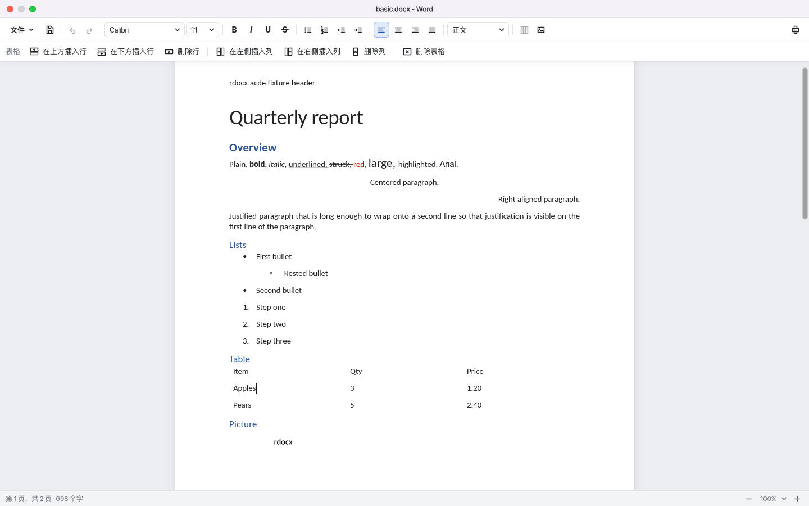
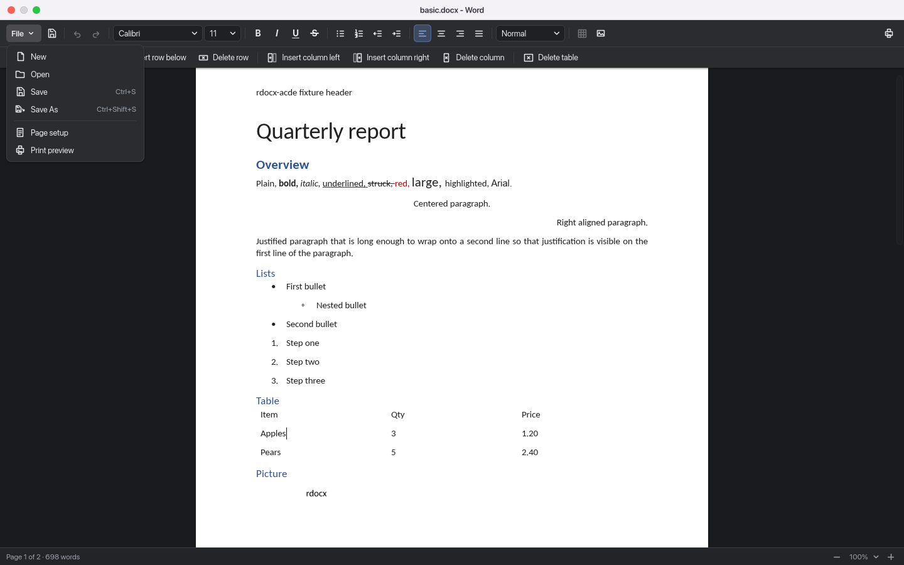

# Folio for Dopame

[English](README.md) | 简体中文

一个运行在 Dopame OS（acde 运行时）上的 `.docx` 编辑器，以窗口应用的形式提供。它打开 Word 文档，按页显示，可以编辑，
保存时不会丢掉文件里它不认识的部分。底层是 Rust 库 [rdocx](https://github.com/tensorbee/rdocx)，编译成 WebAssembly
后在页面里加载。

界面有中文和英文。主要面向中文文档：中日韩文字、宋体和黑体、表格、带编号的标题。



| 光标在表格里时出现的表格条 | 深色主题下的“文件”菜单 |
| --- | --- |
|  |  |

## 功能

- **打开和保存。** 打开 `.docx`，支持保存和另存为。书签、批注、域、内容控件，以及编辑器没有建模的其他 XML，都按原样写回。
  每次保存在写入前都会和打开时的文件核对，会丢内容的保存会被拒绝。
- **文字。** 输入、选择、撤销和重做，加粗、斜体、下划线、删除线，字体、字号、段落样式、对齐、缩进，项目符号和编号列表。
- **结构。** 表格（插入，增删行和列）、图片（PNG 和 JPEG）、分页符，纸张大小、方向和页边距。
- **打印预览和导出 PDF。** 由 rdocx 用本机安装的字体排版，中文用真实的字体绘制。
- **自动化接口。** `window.word.call(request)` 接收一个 JSON 对象，返回一个 JSON 对象。它可以读取文档（`info`、
  `outline`、`blocks`、`text`、`find`、`selection`），也可以编辑文档。编辑走的是和键盘相同的命令，所以每一次自动编辑都看得见，
  也能撤销。数据格式见 [`docs/briefs/r6-automation.md`](docs/briefs/r6-automation.md)。

已知限制：

- 剪贴板和输入法组字没有验证过，因为无界面的会话驱动不了它们。
- 保存出的文件没有在 Microsoft Word 里打开检查过。
- 编辑视图自己分页，和打印预览相比每页可能差一两行。在测试文档上，97% 到 100% 的块在两边落在同一页。

## 结构

| 部分 | 位置 | 作用 |
| --- | --- | --- |
| 模型和命令 | `src/model.ts`、`src/editor/edit.ts` | 文档是普通对象。每次编辑都是一条命令，带撤销历史。 |
| 页面视图 | `src/editor/` | 把块渲染成 HTML，测量、分页，只挂载视口附近的页。光标和选区是自己画的。 |
| 引擎 | `engine/`（Rust）、`src/engine/` | 编译成 WebAssembly 的 rdocx：导入、带校验的保存、打印排版、PDF。 |
| 字体服务 | `server.ts`、`server/fonts.ts` | 应用的后端。列出系统字体并提供字体文件的内容，因为页面读不了字体文件。 |
| 应用外壳 | `src/app.ts`、`src/ui/` | 工具栏、对话框、状态栏、打印预览。 |
| 自动化 | `src/automation/` | `window.word`。 |

输入文字不经过 rdocx。一次按键只改模型和页面的 DOM，rdocx 只在打开、保存和打印预览时运行。这样做的原因和依据的实测数据见
[`docs/design/design.md`](docs/design/design.md)。运行时能做什么、不能做什么，见
[`docs/design/grounding.md`](docs/design/grounding.md)。

## 安装预构建的应用

在已经装好 acde 和 Dopame 运行时的机器上，把[最新 Release](https://github.com/0x00-Community/folio/releases/latest)
里附带的应用包解压到 acde 的包目录：

```sh
mkdir -p ~/.local/share/acde/packages
unzip folio-v0.1.0-package.zip -d ~/.local/share/acde/packages
```

应用包里有界面、后端和引擎，不分 CPU 架构。目前没有 `.dmg` 之类的独立安装包：acde 还没有独立打包的方式，运行时也不允许再分发。

## 环境准备

用于参与开发。


需要 Node 24 或更新版本（测试靠 Node 的类型剥离直接运行 TypeScript）和 `acde` 命令行工具，`npm run dev`、
`npm run build` 和端到端检查都要用。

引擎不在版本库里，有两种方式得到它。

**下载预编译的引擎。** 不需要 Rust：

```sh
npm ci
npm run engine:fetch   # 从 Release 下载 public/engine.wasm 和 src/engine/pkg/
npm run dev            # 在 acde dev 会话里启动应用
```

**从源码编译。** 需要 `rustup`，以及版本正好是 0.2.128 的 `wasm-bindgen` 命令行
（`cargo install wasm-bindgen-cli --version 0.2.128`）。`engine/rust-toolchain.toml` 固定了 Rust 1.97.1 和
`wasm32-unknown-unknown` 目标，第一次编译时 rustup 会自动安装。

```sh
npm ci
npm run engine         # 把 engine/ 编译到 public/engine.wasm 和 src/engine/pkg/
npm run dev
```

引擎依赖的一些 rdocx 改动还没有进上游。它们公开在 [0x00-Community/rdocx](https://github.com/0x00-Community/rdocx)
的 `folio` 分支上，`engine/Cargo.toml` 固定了具体的提交，cargo 会自己拉取。要同时改 rdocx 和引擎，可以在
`engine/.cargo/config.toml` 里用 `[patch]` 把 cargo 指向本地检出。

改动了 `engine/` 之后要重新运行 `npm run engine`。预编译的引擎和它所属的 Release 对应；拉取了 `engine/` 的改动之后，
重新下载或者自己编译。

发布构建不带函数名，能省 4 MB。要在性能分析里看到 Rust 函数名，用 `WORD_ENGINE_NAMES=1 npm run engine` 构建。

## 检查

| 命令 | 运行内容 |
| --- | --- |
| `npm run typecheck` | `tsc --noEmit` |
| `npm test` | 用 `node --test` 跑单元测试。其中一些要加载 `public/engine.wasm`，所以先编译引擎。 |
| `npm run e2e` | 在同一个无界面的 `acde dev` 会话里跑 `scripts/e2e/` 下的全部脚本。可以带脚本名和 `--repeat N`。 |
| 在 `engine/` 里运行 `cargo test` | 引擎的原生测试：导入、保存、未建模内容的清点、打印。 |
| `npm run check` | `acde check`，只校验应用清单。 |

关于端到端检查：

- 项目里任何文件变化，`acde dev` 都会重新加载页面。检查运行期间不要往项目里写文件。
- 截图写到临时目录。设置 `WORD_E2E_EVIDENCE=1` 后，一轮跑完时会把截图拷进 `docs/design/evidence/`。

可选的环境变量：

| 变量 | 用途 |
| --- | --- |
| `WORD_TEST_DOC`、`WORD_TEST_REF_PDF` | 你自己的一份文档，以及 Word 用它导出的 PDF，供打印检查和基准测试使用。不设置就没有任何东西读取它们。 |
| `WORD_TEST_FONTS` | 字体测试读取的目录。默认是 `../rdocx-editing-kit/crates/oxml-layout/fonts`，即本仓库旁边的一份 rdocx 检出。两者都没有时，这些测试会跳过。 |

测量工具：

- `scripts/open-save-bench.mjs`：发布版 wasm 在 Node 里的打开和保存耗时。
- `scripts/history-heap.mjs`：每条撤销记录占用的堆。用 `node --expose-gc` 运行。
- `scripts/print-bench.mjs`：打印排版的耗时和内存。
- `scripts/drift-probe.mjs`：编辑视图的分页和打印排版的分页差多少。

## 目录

```
index.html            页面和样式
server.ts, server/    后端：字体服务
src/                  应用本体（TypeScript，不用框架）
engine/               Rust 引擎 crate
fixtures/             测试用的 .docx 文件
scripts/              引擎构建、端到端检查、基准测试
docs/design/          选定的设计、实测记录、截图
docs/briefs/          每一轮开发的简报和状态
tools/corpus/         生成测试文档的原生工具
```

## 约定

- TypeScript 只用可擦除的语法（不用 `enum`、`namespace`、参数属性），相对导入要带 `.ts` 扩展名。
- 面向用户的文字放在 `src/locales/zh.ts` 和 `src/locales/en.ts`。
- 窗口没有 Web Worker，堆上限是 512 MB。任何慢操作都会卡住整个页面，所以空闲时不做排版。
